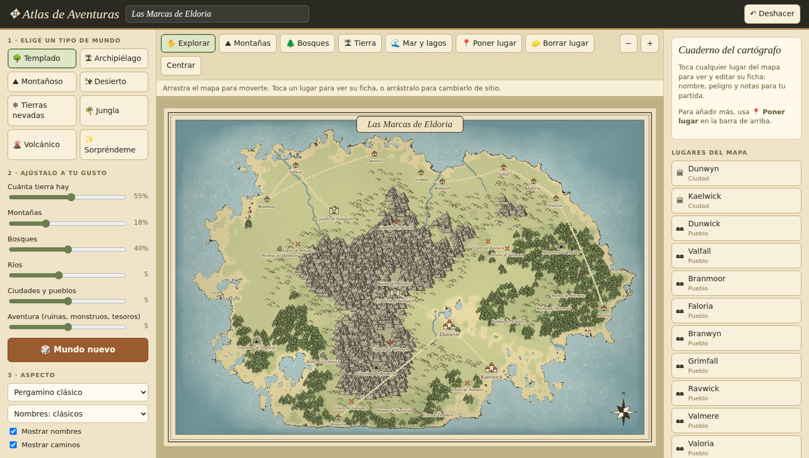
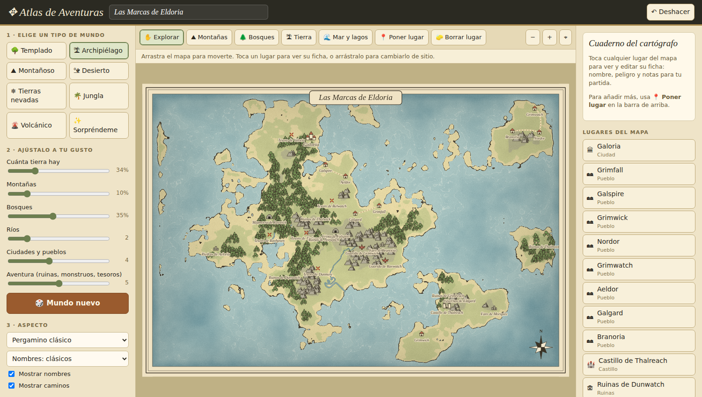

# ✥ Atlas de Aventuras

Generador de mapas de fantasía para jugar a **D&D** (y cualquier otro juego de rol). Un solo archivo HTML, sin instalación ni dependencias: lo abres en el navegador, eliges un tipo de mundo y tienes un mapa con aspecto de dibujado a mano, listo para usar en tu partida.



## Características

- **Aspecto de mapa dibujado:** costas orgánicas con línea de tinta, ondas en el mar, montañas con sombreado y cumbres nevadas, bosques, colinas, ríos que se ensanchan y caminos punteados.
- **Generación en un clic:** siete tipos de mundo (templado, archipiélago, montañoso, desierto, nevado, jungla y volcánico) más un botón "Sorpréndeme".
- **Ajustes sencillos:** seis sliders (tierra, montañas, bosques, ríos, ciudades y aventura). El mapa se regenera en vivo y mantiene la forma del mundo mientras los mueves.
- **Pincel para retocar:** pinta montañas, bosques, tierra o agua a mano. Con `Shift` haces lo contrario.
- **Lugares editables:** ciudades, pueblos, castillos, ruinas, mazmorras, guaridas de monstruos, tesoros y lugares singulares. Cada uno tiene ficha con nombre, nivel de peligro y notas para tu partida, y puedes colocarlos, moverlos y borrarlos.
- **Nombres generados** en cinco estilos: clásico, élfico, nórdico, desértico y celta.
- **Tres estilos visuales:** pergamino clásico, libro de cuentos y fantasía sombría.
- **Exportación:** PNG (hasta 3200 px, apto para imprimir) y guardado/apertura de mapas en JSON.
- **Semilla reproducible:** la misma semilla genera el mismo mundo.
- **Deshacer** con Ctrl+Z.



## Uso

1. Descarga `atlas_de_aventuras.html`.
2. Ábrelo en tu navegador (Chrome, Firefox, Edge o Safari actuales).
3. Elige un tipo de mundo y ajusta los sliders.
4. Retoca con el pincel y coloca tus propios lugares.
5. Descarga el PNG o guarda el JSON para seguir editándolo más tarde.

No necesita servidor ni conexión. Solo la tipografía de títulos y nombres (*IM Fell English*) se carga desde Google Fonts; sin internet se usa Georgia.

## Herramientas

| Herramienta | Qué hace |
|---|---|
| ✋ Explorar | Mueve el mapa, selecciona lugares y los arrastra |
| ⛰ Montañas | Pinta montañas (`Shift` para quitarlas) |
| 🌲 Bosques | Pinta bosques (`Shift` para quitarlos) |
| 🏝 Tierra | Pinta tierra sobre el mar (`Shift` para convertirla en mar) |
| 🌊 Mar y lagos | Pinta agua: lagos, bahías, estrechos |
| 📍 Poner lugar | Coloca un lugar del tipo elegido |
| 🧽 Borrar lugar | Elimina el lugar al que hagas clic |

**Atajos:** rueda del ratón para hacer zoom · `Ctrl+Z` deshacer · `Supr` elimina el lugar seleccionado.

## Opciones avanzadas

- **Semilla:** escribe una para recuperar un mundo concreto.
- **Formato:** apaisado o vertical.
- **Tamaño del PNG:** 1600, 2400 o 3200 px.
- **Rosa de los vientos**, nombres y caminos se pueden mostrar u ocultar.

## Cómo funciona

El terreno es un mapa de alturas generado con ruido fractal sobre una cuadrícula, y se pinta píxel a píxel con interpolación, de ahí las costas suaves. Montañas, colinas y árboles se colocan de forma determinista a partir de la altura y la humedad de cada zona, y los ríos bajan por la pendiente hasta el mar. Todo se dibuja en un `<canvas>` con JavaScript puro.

## Estructura del proyecto

```
atlas_de_aventuras.html   # toda la aplicación (HTML + CSS + JS)
docs/                     # capturas para este README
```

## Contribuir

Las ideas y los pull requests son bienvenidos. Si encuentras un fallo, abre un *issue* indicando la semilla del mapa y los ajustes que usabas, así se puede reproducir.
